<!-- ░░░ wasmquay ░░░ -->
<div align="center">



```text
╔══════════════════════════════════════════════════════════════════════╗
║  w a s m q u a y  ·  the dry-dock for WebAssembly components           ║
║  inspect · classify · gate · compare — 100% offline, 0 dependencies    ║
╚══════════════════════════════════════════════════════════════════════╝
```

**A mixed-language toolkit that decodes real `.wasm` binaries, classifies the
capabilities they demand from the host, and gates them against explicit
policies — then hands a typed JSON manifest to a static TypeScript explorer.**

`rust · std-only` &nbsp;•&nbsp; `typescript · tsc-only` &nbsp;•&nbsp; `no network` &nbsp;•&nbsp; `no runtime magic`

</div>

---

## `0x00` — TL;DR for the impatient

```console
$ cargo build --release                         # zero third-party crates
$ ./target/release/wasmquay gen-fixtures fixtures
wrote fixtures/clock-service.wasm (139 bytes)
wrote fixtures/net-service.wasm (208 bytes)
wrote fixtures/fs-component.wasm (135 bytes)
wrote fixtures/opaque-host.wasm (69 bytes)

$ ./target/release/wasmquay inspect fixtures/net-service.wasm
wasmquay inspection :: net-service.wasm
  version=1  bytes=208  sections=3
  module-name: net-service
  imports=5 (funcs=4, memories=1)  exports=1
  capability domains:
    - fs       x1
    - clock    x1
    - network  x2

$ ./target/release/wasmquay policy fixtures/net-service.wasm examples/sandbox-strict.pol
policy 'sandbox-strict': VIOLATION
  [allow] fs       (1 reqs)
  [allow] clock    (1 reqs)
  [DENY ] network  (2 reqs)
$ echo $?
3
```

That last exit code is the point: **wasmquay is designed to gate CI**. A
component that reaches for a capability its policy forbids fails the build.

---

## `0x01` — What this actually is (and is not)

wasmquay is a **static analyzer** for the WebAssembly ecosystem. It answers one
question well: *what can this component do to the outside world, and is that
allowed?*

A WebAssembly module is a sealed box. The only way it can touch a filesystem,
open a socket, read the clock, or learn the time of day is through the host
functions it **imports**. wasmquay decodes those imports straight from the
binary, buckets each one into a capability **domain**, and checks the result
against a policy you write in plain text.

> ### ⚠️ Scope & honesty
> wasmquay **does not execute, instantiate, or sandbox** WebAssembly. It is not
> a runtime and makes no runtime-enforcement claims. When the docs say
> "enforce", they mean *analyze against a stated policy at inspection time* —
> the kind of check you run in CI, not an interception layer around a live
> module. Everything it reports is derived from bytes on disk. That honesty is a
> feature: the analysis is deterministic, offline, and auditable.

What it genuinely does, verified by its own test suite:

- **Decodes** the WebAssembly core binary format: the `\0asm` header, the
  section table (ids/offsets/sizes), the import and export sections, and the
  custom `name` section (module + function names).
- **Classifies** every host import into `fs · env · clock · network · random ·
  stdio · unknown`, covering both WASI preview1 function names and preview2 /
  component-model interface paths.
- **Evaluates** a component's capability set against an explicit, deny-by-default
  policy with per-domain allow-lists.
- **Compares** two components for substitutability (is B a safe drop-in for A?).
- **Reads** a documented WIT-like interface manifest subset.
- **Emits** stable, versioned JSON and human text — consumed by a companion
  **TypeScript explorer** that computes risk scores and reconciles findings.

---

## `0x02` — Architecture

```text
